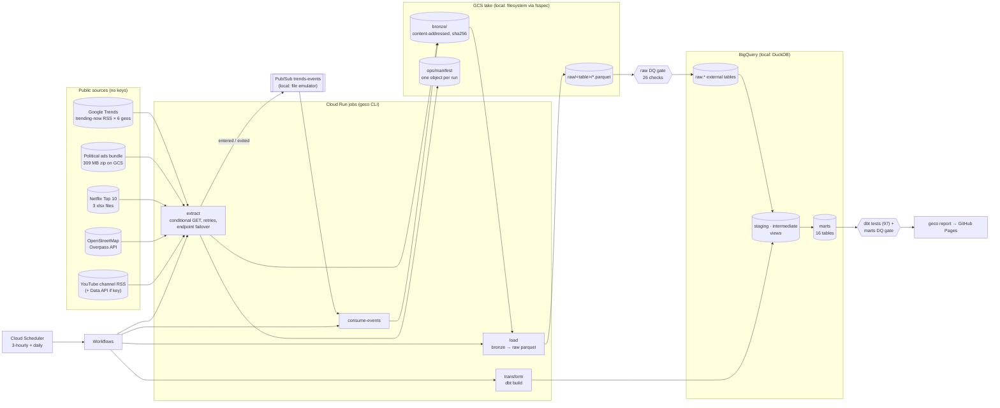

# Google ecosystem analytics: Search, Ads, YouTube vs Netflix, Maps

[](https://github.com/rohit91jacob/google-youtube-maps-search-ads/actions/workflows/ci.yml)
[](https://github.com/rohit91jacob/google-youtube-maps-search-ads/actions/workflows/refresh.yml)
[](https://rohit91jacob.github.io/google-youtube-maps-search-ads/)
[](LICENSE)
[](DATA_LICENSE.md)


A data-engineering project on five **real, public, credential-free** sources from the Google
ecosystem and its main streaming rival, designed for GCP and run locally on emulators:

* **Search**: the Google Trends trending-now feed for 6 countries, polled every 3 hours by the scheduled job. Poll-to-poll
  diffs go through a **Pub/Sub** event stream. Marts: churn and how long searches stay trending.
* **Ads**: Google's political-ads transparency bundle (the files behind BigQuery's
  `google_political_ads`): 306,378 advertiser-weeks of spend across 12 regions since 2018. Marts:
  spend by advertiser, region and week, and by US state.
* **YouTube vs Netflix**: upload cadence of 7 official YouTube channels from their public RSS feeds,
  and Netflix's official Top 10 files (11,000 global and 512,200 per-country weekly rows since June
  2021). Marts: title longevity, language mix, country reach, a same-week side-by-side.
* **Maps**: OpenStreetMap amenity counts via Overpass in the same 10 km × 10 km box in 8 cities.
  Mart: amenities per km², by category.

The stack is GCP's: Cloud Run jobs → GCS bronze → BigQuery with dbt, orchestrated by Workflows +
Cloud Scheduler, plus Pub/Sub. Locally, GCS is a filesystem behind fsspec, BigQuery is DuckDB
(dbt also has a BigQuery target, which CI compiles), and Pub/Sub is a file-backed emulator; CI also
runs against the official Pub/Sub emulator and fake-gcs-server. The production infrastructure is
Terraform (CMEK everywhere, least-privilege service accounts, keyless Workload Identity Federation
for GitHub Actions, a budget). It is validated by `terraform validate`, tflint and checkov, and has
**never been applied**: no cloud account was used.

**Proof.** The pipeline's numbers are reconciled with figures the sources publish
([verification](docs/verification.md)). Netflix's own weeks-in-Top-10 counter matches the recount
for 3,992 of 3,998 titles; all 6 differences are different films sharing a title. Summed weekly
political-ad spend equals Google's lifetime total for Biden for President to within $400 of
$100.66 M. Two currencies' weekly files disagree with Google's own totals (ZAR by 18.5%), and the
pipeline flags that rather than hiding it.

**Live results.** A scheduled GitHub Actions job polls Trends every 3 hours and rebuilds everything
daily, then publishes **[rohit91jacob.github.io/google-youtube-maps-search-ads](https://rohit91jacob.github.io/google-youtube-maps-search-ads/)**.
No credentials are involved.

## Architecture



| Component | Code | What it does |
|---|---|---|
| Extractors | `src/geco/sources/*.py` | One module per source. Bronze objects are content-addressed (`bronze/<source>/<dataset>/<sha256>.<ext>`), so an unchanged file is never stored twice. Political ads and Netflix use ETag/Last-Modified (HTTP 304). Overpass fails over between endpoints. The ads extractor streams the 309 MB zip to disk and keeps 5 of its 12 files (not the 2.9 GB creative file). |
| Manifest | `src/geco/lake.py` | Append-only, one JSONL object per run (works on object stores). Records every fetch and poll, including unchanged and failed ones. |
| Lake | `src/geco/lake.py` | fsspec abstraction: `file://` locally, `gs://` with gcsfs, `memory://` in tests, fake-gcs-server in CI. |
| Event stream | `src/geco/pubsub.py`, `sources/trends.py` | Each Trends poll is diffed against the previous one. `entered`/`exited` events with deterministic ids are published (ordering key = geo), drained to bronze and acked only after the write. Backends: local emulator or google-cloud-pubsub. |
| Raw layer | `src/geco/raw.py` | Rebuilds 15 typed parquet tables from bronze + manifest on every load (deterministic, sorted). These are BigQuery external tables in production. |
| Data quality | `src/geco/quality/checks.py`, dbt tests | 26 raw checks (grain, ranges, parse failures, weekdays, freshness, cross-file reconciliation) gate dbt. 97 dbt tests plus 4 mart checks gate the site. Error-level failure = exit 3. |
| Transform | `dbt/` | Staging → intermediate → 16 marts, with portable macros (`dbt/macros/cross_db.sql`) so the same SQL runs on DuckDB and BigQuery. |
| Orchestration | `src/geco/pipeline.py`, `infra/workflows/pipeline.yaml` | `geco run` locally; on GCP, Workflows runs the jobs (`mode=full` daily, `mode=trends` every 3 h). |
| Site | `src/geco/report.py` | Static HTML with inline SVG charts, `summary.json` and CSV exports. |
| Infra | `infra/` | Terraform modules: kms, storage, bigquery, pubsub, iam, cloud_run_jobs, orchestration, wif, budget. |

## Tech stack

All Python versions are pinned in `uv.lock`.

| Layer | Technology | Version |
|---|---|---|
| Language | Python | 3.12 |
| Packaging | uv, hatchling | uv 0.10 |
| DataFrames / parsing | Polars, fastexcel (calamine), defusedxml | 2.0.0, 0.21.0, 0.7.1 |
| Local warehouse (BigQuery stand-in) | DuckDB | 1.5.6 |
| Transform | dbt-core, dbt-duckdb, dbt-bigquery | 1.12.5, 1.11.0, 1.12.1 |
| Object store | fsspec, gcsfs | 2025.12.0 |
| Messaging | google-cloud-pubsub (+ local emulator) | 2.42.0 |
| CLI / config | Typer, pydantic-settings | 0.27.3, 2.15 |
| IaC | Terraform, hashicorp/google provider | 1.16.5, 8.6.0 |
| IaC checks | tflint (+ google ruleset), checkov | 0.64.0 (0.40.0), 3.3.26 |
| Emulators (CI) | gcloud Pub/Sub emulator, fake-gcs-server | 588.0.0, 1.56.1 |
| Quality tooling | pytest 9.1, ruff 0.16, sqlfluff (BigQuery parse), pre-commit, gitleaks, Dependabot | |

## Data sources

| Source | Domain | Endpoint | Licence / terms | Refresh (source → here) | Known gaps |
|---|---|---|---|---|---|
| Google Trends trending now | Search | `trends.google.com/trending/rss?geo=…` (US, GB, IN, BR, JP, DE) | Google ToS; not redistributed | continuous → every 3 h | Only the ~10 searches trending *now*. No history: longevity is observed from our polls, resolution = poll interval. Traffic is a bucket (`200+`). |
| Political Advertising on Google | Ads | `storage.googleapis.com/political-csv/google-political-ads-transparency-bundle.zip` | Published for transparency; not redistributed | regenerated daily (weekly file on Tuesdays) → daily, HTTP 304 when unchanged | Spend rounded to 100 units, in each region's own currency (no FX conversion). No EU rows in the current bundle. Some currencies' weekly files disagree with totals (verification). |
| Netflix Top 10 | Streaming | `netflix.com/tudum/top10/data/*.xlsx` | Netflix ToU; not redistributed | weekly (Tuesdays) → daily | Only titles in a Top 10. Views from June 2023 only. No title id: different titles with the same name merge. |
| OpenStreetMap via Overpass | Maps | `overpass-api.de/api/interpreter` (+ mirrors) | **ODbL 1.0**, © OpenStreetMap contributors | continuous → weekly | Counts measure *mapping completeness* as much as the city. Boxes include water. Overpass is often busy; stale counts are kept. |
| YouTube channel RSS | Video | `youtube.com/feeds/videos.xml?channel_id=…` (7 channels) | YouTube ToS; not redistributed | continuous → daily | Only the latest 15 uploads per poll; history grows with polling. View counts are lifetime-to-date. |
| YouTube Data API v3 (optional) | Video | `googleapis.com/youtube/v3` | YouTube API ToS | daily, only if `YOUTUBE_API_KEY` is set | Off in this repo's runs; tested with synthetic recorded-shape responses. |

Details and attribution: [DATA_LICENSE.md](DATA_LICENSE.md). **Committed fixtures:** 8 real OSM
responses (ODbL). Everything else under `tests/fixtures/synthetic/` is **synthetic**, seeded, and
labelled as such, because the other sources' terms do not permit redistribution.

## Data model

| Layer | Tables (grain) |
|---|---|
| Bronze | original payloads, content-addressed; `ops/manifest` (one line per fetch/poll) |
| Raw | `trends_polls` (geo × poll), `trends_items` (geo × poll × rank), `trends_events` (event), `ads_advertisers`, `ads_advertiser_spend_totals`, `ads_weekly_spend` (advertiser × week × currency), `ads_advertiser_geo_spend`, `ads_geo_spend`, `ads_report_updated`, `netflix_global_weekly` (week × list × rank), `netflix_country_weekly`, `netflix_most_popular`, `osm_amenity_counts` (city × amenity × fetch), `youtube_videos` (video × poll), `youtube_channels` |
| Staging | one `stg_<source>__<entity>` view per raw table (renames, types, dedup, derived language/type) |
| Marts: Search | `mart_trends_churn_by_geo`, `mart_trends_term_longevity`, `mart_trends_geo_summary`, `fct_trends_events` |
| Marts: Ads | `dim_political_advertiser`, `fct_political_ad_spend_weekly`, `mart_political_ad_spend_region_week`, `mart_political_ad_top_advertisers`, `mart_political_ad_spend_us_state` |
| Marts: Streaming | `mart_netflix_title_longevity`, `mart_netflix_language_mix_weekly`, `mart_netflix_country_reach` |
| Marts: Maps | `mart_osm_amenity_density`, `mart_osm_city_profile` |
| Marts: Video | `mart_youtube_upload_cadence`, `mart_video_attention_weekly` |

Every column and definition (churn, observed hours, report region, city box, …) is in the
**[data dictionary](docs/data_dictionary.md)**.

## Results from the 9 October 2026 run

These come from real downloads on 9 October 2026 ([verification](docs/verification.md) has the
reconciliations). The live site updates daily.

| Domain | Result |
|---|---|
| Search | 24 polls (4 per geo over 4.7 h) → 204 Pub/Sub events, every one matching the snapshot diff. Average poll-to-poll churn 33% (BR) to 47% (US, JP), but the 3 gaps between polls were 8 min, 4.6 h and 4 min, so these averages mix very different intervals: over the 4.6 h gap all 10 searches had changed in every geo, over the two short gaps 0 to 4 of 10. Churn per 3-hour interval needs the scheduled polls. |
| Ads | US: $2.89 B over 17,115 advertisers since May 2018. Top: Biden for President $100.7 M, Donald J. Trump for President $81.7 M, Harris Victory Fund $75.9 M. Calendar 2024: $841 M. |
| Streaming | KPop Demon Hunters: 67 weeks in the global Top 10, the longest of any title. Week ending 4 Oct 2026: English TV 39.5% of Top 10 hours, non-English TV 29.8%. Since June 2021, non-English titles hold 37.8% of Top 10 hours. |
| Maps | Amenities per km² in the 10 km box: Paris 289, Berlin 253, Tokyo 242, London 174, New York 122, São Paulo 77, Bengaluru 59, Delhi 20 (OSM data of 9 Oct 2026). |
| Video | Netflix's YouTube channel posts the most often (median 3.0 h between uploads); Google DeepMind the least (median 25.7 h; 1.6 uploads/week). |

## Quickstart

Prerequisites: Python 3.12 and [uv](https://docs.astral.sh/uv/). For the infra checks: Terraform
≥ 1.9 and tflint. Docker is **not** needed locally.

```bash
git clone https://github.com/rohit91jacob/google-youtube-maps-search-ads.git
cd google-youtube-maps-search-ads
uv sync --frozen --all-extras

# 1. Offline, on the committed fixtures (about 45 s): 3 Trends polls, every source, dbt build, site
uv run geco fixtures-run --data-dir data/fixtures --site data/fixtures/site

# 2. Real data (about 2 min, plus up to 6 min if Overpass is busy). Downloads ~330 MB.
export GECO_DATA_DIR=~/projects/_data/google-youtube-maps-search-ads/live
uv run geco run --site site        # extract -> Pub/Sub -> load + DQ -> dbt build + DQ -> site
uv run geco poll-trends            # repeat later to grow the Trends history
uv run geco report --out site      # rebuild the site from the warehouse (make report)
uv run geco sql "select * from marts.mart_osm_city_profile order by amenities_per_km2 desc"
```

`make help` lists every target (tests, `pipeline-fixtures`, `dbt-compile-bq`, `infra-check`, …).

| Command | |
|---|---|
| `uv run pytest` | unit + end-to-end tests (no network) |
| `uv run pytest -m integration` | Pub/Sub emulator + fake-gcs-server (set `PUBSUB_EMULATOR_HOST`, `GECO_TEST_GCS_ENDPOINT`; CI starts both) |
| `uv run pytest -m live` | smoke test against the real Trends feed |
| `make dbt-compile-bq` | compile all models for BigQuery offline and parse them |
| `make infra-check` | terraform fmt/validate, tflint, checkov |

## Local emulator → real GCP service

| Concern | Local / CI | Production GCP | Switch |
|---|---|---|---|
| Extract / load / transform compute | `geco` CLI process | Cloud Run jobs `geco-extract`, `geco-load`, `geco-transform` (same image, `Dockerfile`) | `infra/modules/cloud_run_jobs` |
| Object storage (bronze, raw, ops) | local directory via fsspec; fake-gcs-server in CI | GCS bucket, CMEK, uniform access, lifecycle | `GECO_LAKE_URI=gs://…` |
| Warehouse | DuckDB file; `raw` = views over parquet | BigQuery datasets `raw` (external tables) / `staging` / `intermediate` / `marts` / `seeds` | `DBT_TARGET=bigquery` |
| Event stream | file-backed Pub/Sub emulator in the lake; official emulator in CI | Pub/Sub topic + ordered subscription + dead-letter topic | `GECO_PUBSUB_BACKEND=gcp` |
| Orchestration | `geco run`, `geco poll-trends`; GitHub Actions cron | Workflows + Cloud Scheduler (daily + every 3 h) | `infra/modules/orchestration` |
| Secrets | `.env` (optional `YOUTUBE_API_KEY`) | Secret Manager, mounted into the extract job | `enable_youtube_api` |
| CI → cloud auth | none | Workload Identity Federation (OIDC, no keys), `deploy.yml` gated on repo variables | `infra/modules/wif` |
| Results site | GitHub Pages (`refresh.yml`) | unchanged | – |

## Cost notes

* **As run here: $0.** Everything runs on a laptop or free GitHub Actions minutes. The only network
  cost is the downloads (~330 MB per daily run, mostly the political-ads zip, which is skipped with
  HTTP 304 when unchanged).
* **On GCP (not deployed; an estimate, not a measurement):** the bronze lake grows by about 21 MB
  per day when the political-ads bundle changes (one new version of its 5 files), bounded by
  `geco prune` / lifecycle rules and moved to Nearline after 30 days. All raw parquet was 4.7 MB
  (zstd) on 9 Oct 2026, so a dbt build scans well under 1 GB. The jobs run a few minutes per day.
  This should sit within or close to the free tiers. The budget alert defaults to 10 units of the
  billing currency per month; the hard guardrail is `maximum_bytes_billed` (10 GB per query) in the
  dbt BigQuery profile. The 6 KMS keys cost about $0.06 per key version per month.

## Limitations

* **Emulated, not deployed.** Terraform is validated but has never been applied, and the BigQuery
  target is compiled and SQL-parsed in CI but has not run against real BigQuery. The CI jobs that
  need Docker (emulators, image build) have not been run locally, because this machine has no
  Docker.
* **Trends history is our own.** The feed has no history, so churn and longevity depend on how long
  and how often this project has polled (4 polls on 9 Oct 2026 at the time of writing).
  Observed lifetimes are lower bounds.
* **YouTube vs Netflix is context, not a ranking.** Netflix views (hours ÷ runtime per week) and
  YouTube lifetime view counts are different measures; the mart puts them side by side and says so.
* **OSM density measures mapping as well as amenities.** Delhi's 20/km² against Paris's 289/km²
  reflects OSM coverage as much as reality, and the boxes include rivers and parks.
* Political ad spend is not converted between currencies. Netflix titles with the same name are
  merged (6 of 3,998 on 9 Oct 2026).
* The YouTube Data API path is tested only with synthetic recorded-shape responses.

## Repository layout

```
src/geco/            CLI, extractors (sources/), lake + manifest, Pub/Sub, raw build, DQ, report
dbt/                 dbt project: staging / intermediate / marts, macros, seeds, singular tests
infra/               Terraform root + modules + Workflows definition
tests/               unit/, e2e/ (fixtures + idempotent rerun), integration/ (emulators), fixtures/
scripts/             synthetic fixture generator, data dictionary generator, verification script
docs/                data_dictionary.md, runbook.md, verification.md
.github/workflows/   ci.yml, refresh.yml (scheduled + Pages), keepalive.yml, deploy.yml (gated)
```

See also the [runbook](docs/runbook.md) (stages, exit codes, failures, deploying to real GCP).
